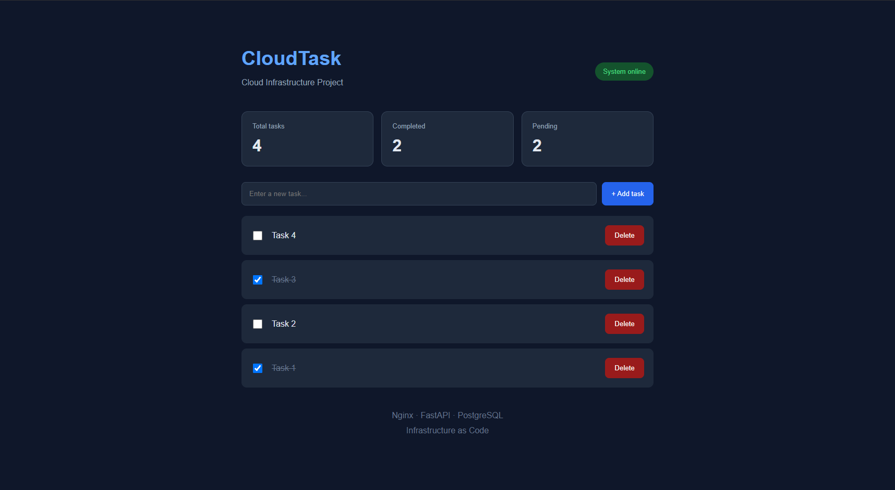
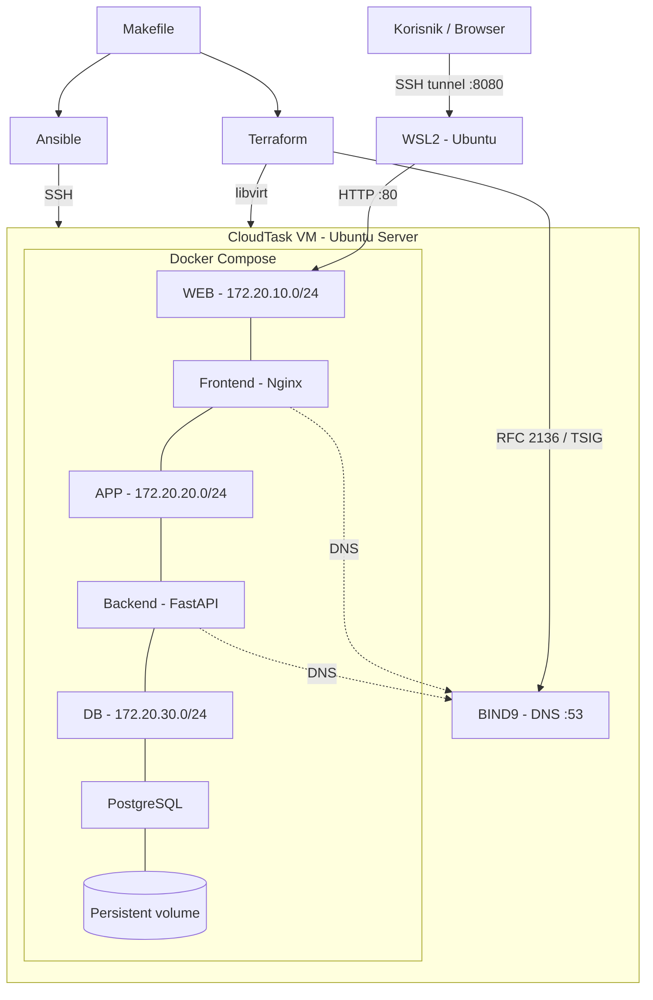

# CloudTask – Troslojna aplikacija kao kod

**Univerzitet u Zenici**  
**Politehnički fakultet**  
**Predmet:** Računarstvo u oblaku  
**Student:** Emrah Jamaković  
**Akademska godina:** 2026/2027.

## 1. Opis projekta

CloudTask predstavlja troslojnu web aplikaciju za upravljanje zadacima, čija se infrastruktura kreira i konfiguriše korištenjem principa Infrastructure as Code (IaC).

Aplikacija omogućava:

- Kreiranje zadataka.
- Pregled postojećih zadataka.
- Označavanje zadataka kao završenih.
- Brisanje zadataka.
- Prikaz statistike zadataka.
- Provjeru dostupnosti aplikacije i baze podataka.

Primarni cilj projekta nije kompleksnost aplikacije, nego automatizovano kreiranje infrastrukture, konfiguracija servera, mrežna segmentacija, upravljanje DNS zapisima, zaštita tajni i ponovljivost sistema.



## 2. Korištene tehnologije

| Tehnologija | Namjena |
|---|---|
| WSL2 | Lokalno Linux razvojno okruženje |
| Ubuntu 24.04 LTS | Operativni sistem |
| QEMU/KVM | Virtualizacija |
| Libvirt | Upravljanje virtuelnim mašinama |
| Terraform | Deklarativno kreiranje infrastrukture |
| Cloud-init | Inicijalna konfiguracija VM-a |
| Ansible | Automatizovana konfiguracija servera |
| Docker | Kontejnerizacija |
| Docker Compose | Orkestracija kontejnera |
| BIND9 | Autoritativni DNS server |
| TSIG | Autentifikacija DNS ažuriranja |
| Nginx | Frontend web server i reverse proxy |
| Python FastAPI | Backend REST API |
| PostgreSQL | Relacijska baza podataka |
| Make | Automatizacija životnog ciklusa infrastrukture |
| Git | Verzioniranje izvornog koda |

Testirano okruženje:

- Windows 11.
- AMD Ryzen 5 5600.
- 32 GB RAM.
- Ubuntu 24.04.5 LTS unutar WSL2.
- Ansible Core 2.16.3.
- Terraform libvirt provider 0.8.3.
- Terraform DNS provider 3.6.2.
- Docker Engine 29.1.3.
- Docker Compose 2.40.3.

## 3. Arhitektura sistema

Odabrana je arhitektura s jednom virtuelnom mašinom i tri zasebne Docker mreže.

Virtuelna mašina predstavlja aplikacijski server na kojem se izvršavaju frontend, backend, PostgreSQL i autoritativni DNS server.



### 3.1. Parametri virtuelne mašine

| Parametar | Vrijednost |
|---|---|
| Naziv | cloudtask-server |
| Operativni sistem | Ubuntu Server 24.04 LTS |
| CPU | 2 vCPU |
| RAM | 4096 MiB |
| Disk | 20 GiB |
| Korisnik | cloudadmin |
| Autentifikacija | SSH Ed25519 ključ |
| Virtuelna mreža | libvirt default |
| Storage pool | default |

Parametri virtuelne mašine definisani su Terraform varijablama.

IP adresa virtuelne mašine dodjeljuje se dinamički i dostupna je putem Terraform outputa.

## 4. Mrežna segmentacija

Definisane su tri zasebne Docker bridge mreže.

| Mreža | Podmreža | Namjena |
|---|---|---|
| cloudtask_web | 172.20.10.0/24 | Pristup frontend sloju |
| cloudtask_app | 172.20.20.0/24 | Komunikacija frontenda i backenda |
| cloudtask_db | 172.20.30.0/24 | Komunikacija backenda i baze |

### 4.1. Plan adresiranja

| Komponenta | Mreža | IP adresa |
|---|---|---|
| Frontend | WEB | 172.20.10.10 |
| Frontend | APP | 172.20.20.10 |
| Backend | APP | 172.20.20.20 |
| Backend | DB | 172.20.30.20 |
| PostgreSQL | DB | 172.20.30.30 |

### 4.2. Dozvoljeni komunikacijski tokovi

| Izvor | Odredište | Port | Status |
|---|---|---|---|
| Korisnik | Frontend | TCP 80 | Dozvoljeno |
| Frontend | Backend | TCP 8000 | Dozvoljeno |
| Backend | PostgreSQL | TCP 5432 | Dozvoljeno |
| Frontend | PostgreSQL | TCP 5432 | Blokirano |

Samo frontend ima objavljen aplikacijski port na virtuelnoj mašini.

Backend i PostgreSQL nemaju objavljene portove.

DB mreža dodatno je definisana kao interna Docker mreža korištenjem parametra `internal: true`.

Mrežna izolacija potvrđena je automatizovanim TCP testovima.

## 5. DNS infrastruktura

BIND9 je konfigurisan kao autoritativni DNS server za zonu `cloudtask.test`.

| Parametar | Vrijednost |
|---|---|
| DNS zona | cloudtask.test |
| Autoritativni server | ns1.cloudtask.test |
| DNS port | 53 TCP/UDP |
| TTL | 300 sekundi |
| Rekurzija | Onemogućena |
| Zone transfer | Onemogućen |
| TSIG algoritam | HMAC-SHA256 |

### 5.1. DNS zapisi

| DNS ime | Tip | Vrijednost |
|---|---|---|
| ns1.cloudtask.test | A | IP virtuelne mašine |
| frontend.cloudtask.test | A | IP virtuelne mašine |
| backend.cloudtask.test | A | 172.20.20.20 |
| db.cloudtask.test | A | 172.20.30.30 |

Ansible instalira BIND9 i priprema inicijalnu DNS zonu sa SOA i NS zapisima te adresom DNS servera.

Aplikacijske DNS zapise kreira Terraform korištenjem HashiCorp DNS providera i RFC 2136 protokola.

Nginx pristupa backendu korištenjem DNS imena `backend.cloudtask.test`, dok backend pristupa PostgreSQL bazi korištenjem imena `db.cloudtask.test`.

### 5.2. TSIG autentifikacija

Dinamičko ažuriranje DNS zapisa zahtijeva validan TSIG ključ.

Politika ažuriranja:

```text
update-policy {
    grant cloudtask-update. zonesub A;
};
```

Ključ omogućava ažuriranje A zapisa unutar projektne zone, ali ne i proizvoljnu izmjenu drugih tipova zapisa.

Testiranjem je potvrđeno:

- Ažuriranje bez TSIG ključa: REFUSED.
- Pokušaj izmjene TXT zapisa validnim ključem: REFUSED.
- Pokušaj izmjene zapisa u nepostojećoj vanjskoj zoni: NOTAUTH.
- Terraform ažuriranje A zapisa: uspješno.

## 6. Struktura projekta

```text
cloudtask/
├── .gitignore
├── Makefile
├── README.md
├── app/
│   ├── backend/
│   │   ├── Dockerfile
│   │   ├── main.py
│   │   └── requirements.txt
│   ├── frontend/
│   │   ├── Dockerfile
│   │   ├── index.html
│   │   ├── style.css
│   │   ├── app.js
│   │   └── nginx.conf
│   └── compose.yaml
├── cloud-init/
│   └── user-data.tftpl
├── terraform/
│   ├── vm/
│   │   ├── providers.tf
│   │   ├── variables.tf
│   │   ├── main.tf
│   │   └── outputs.tf
│   └── dns/
│       ├── providers.tf
│       ├── variables.tf
│       ├── main.tf
│       └── outputs.tf
├── ansible/
│   ├── ansible.cfg
│   ├── requirements.yml
│   ├── group_vars/
│   ├── site.yml
│   ├── deploy.yml
│   └── roles/
│       ├── common/
│       ├── docker/
│       ├── dns/
│       └── app/
├── scripts/
│   ├── bootstrap.sh
│   ├── generate-inventory.sh
│   ├── generate-secrets.sh
│   ├── wait-for-server.sh
│   ├── dns.sh
│   └── test.sh
├── tests/
│   ├── dns.sh
│   ├── network.sh
│   ├── persistence.sh
│   ├── drift.sh
│   └── tsig.sh
└── docs/
    └── evidence/
```

Terraform lock fajlovi uključeni su u repozitorij radi ponovljivosti verzija providera.

Terraform state, lokalne tajne, generisani Ansible inventory i runtime fajlovi nisu dio repozitorija.

## 7. Preduslovi za pokretanje

Projekat zahtijeva Linux okruženje s funkcionalnom KVM/libvirt virtualizacijom.

Testiran je na Ubuntu 24.04 LTS unutar WSL2 okruženja.

Na Windowsu je moguće instalirati Ubuntu naredbom iz administratorskog PowerShella:

```powershell
wsl --install -d Ubuntu-24.04
```

Potrebno je omogućiti hardversku virtualizaciju i osigurati podršku za ugniježđenu virtualizaciju ako se koristi WSL2.

Provjera KVM uređaja:

```bash
ls -l /dev/kvm
```

Instalacija osnovnih razvojnih alata na Ubuntu sistemu:

```bash
sudo apt update
sudo apt install -y git curl wget unzip make jq python3 python3-pip python3-venv openssh-client gnupg ca-certificates dnsutils openssl
```

Instalacija virtualizacijskog okruženja:

```bash
sudo apt install -y qemu-kvm qemu-utils libvirt-daemon-system libvirt-clients virtinst cloud-image-utils bridge-utils
```

Pokretanje libvirt servisa:

```bash
sudo systemctl enable --now libvirtd
sudo usermod -aG libvirt,kvm $USER
```

Nakon dodjeljivanja korisničkih grupa potrebno je ponovo pokrenuti sesiju.

Provjera virtualizacije:

```bash
sudo virt-host-validate qemu
virsh -c qemu:///system list --all
virsh -c qemu:///system net-list --all
```

Instalacija Ansiblea:

```bash
sudo apt install -y ansible
```

Terraform se instalira iz službenog HashiCorp APT repozitorija:

```bash
wget -O- https://apt.releases.hashicorp.com/gpg | sudo gpg --dearmor -o /usr/share/keyrings/hashicorp-archive-keyring.gpg
```

```bash
echo "deb [arch=$(dpkg --print-architecture) signed-by=/usr/share/keyrings/hashicorp-archive-keyring.gpg] https://apt.releases.hashicorp.com $(lsb_release -cs) main" | sudo tee /etc/apt/sources.list.d/hashicorp.list
```

```bash
sudo apt update
sudo apt install -y terraform
```

Potrebno je da postoji libvirt mreža pod nazivom `default`.

Bootstrap skripta automatski provjerava potrebne alate, aktivira postojeću libvirt mrežu, priprema storage pool, generiše SSH ključeve i tajne te instalira potrebnu Ansible kolekciju.

## 8. Pokretanje projekta

Iz glavnog direktorija repozitorija potrebno je izvršiti:

```bash
make all
```

Naredba automatski izvršava:

1. Provjeru preduslova.
2. Pripremu libvirt storage poola.
3. Generisanje SSH ključeva i tajni.
4. Terraform inicijalizaciju i kreiranje VM-a.
5. Automatsko generisanje Ansible inventoryja.
6. Čekanje dostupnosti SSH konekcije.
7. Ansible konfiguraciju servera.
8. Instalaciju Dockera i BIND9.
9. Terraform kreiranje DNS zapisa.
10. Build aplikacijskih Docker slika.
11. Pokretanje Docker kontejnera.
12. Provjeru dostupnosti aplikacije.

Docker, Docker Compose i BIND9 nije potrebno ručno instalirati unutar projektne virtuelne mašine.

## 9. Pristup aplikaciji

Za pristup aplikaciji iz Windows browsera koristi se SSH port forwarding.

U zasebnom terminalu izvršiti:

```bash
make tunnel
```

Aplikacija je dostupna na adresi:

http://localhost:8080

SSH tunel mora ostati aktivan dok se koristi aplikacija.

Prekid SSH tunela ne zaustavlja virtuelnu mašinu niti aplikacijske kontejnere.

Za testiranje aplikacije direktno iz Linux upravljačkog okruženja:

```bash
curl http://$(terraform -chdir=terraform/vm output -raw vm_ip)/api/health
```

Očekivani odgovor:

```json
{
  "status": "healthy",
  "database": "connected"
}
```

## 10. Makefile naredbe

| Naredba | Opis |
|---|---|
| make all | Kompletno podizanje infrastrukture i aplikacije |
| make check | Provjera alata i priprema okruženja |
| make infra | Kreiranje virtuelne mašine i inventoryja |
| make config | Konfiguracija servera |
| make dns | Kreiranje DNS zapisa |
| make deploy | Build i pokretanje aplikacije |
| make test | Automatizovani infrastrukturni testovi |
| make tsig | Provjera ograničenja TSIG ključa |
| make drift | Demonstracija i ispravljanje DNS drifta |
| make tunnel | SSH port forwarding |
| make destroy | Uklanjanje projektne infrastrukture |

**Napomena:** Naredba `make destroy` uklanja virtuelnu mašinu i sve podatke koji se nalaze na njenom virtuelnom disku. Lokalni izvorni kod i generisane tajne ostaju sačuvani.

## 11. Upravljanje tajnama

Tajne se generišu automatski korištenjem OpenSSL alata.

Generišu se:

- PostgreSQL lozinka od 32 slučajna bajta u HEX formatu.
- TSIG tajna od 32 slučajna bajta u Base64 formatu.
- Ed25519 SSH par ključeva.

Lokalne aplikacijske tajne nalaze se u direktoriju `.secrets/`.

Direktorij ima dozvolu 700, a fajlovi s tajnama dozvolu 600.

Ansible učitava tajne korištenjem lookup funkcije.

PostgreSQL lozinka dostavlja se aplikaciji putem zaštićenog `.env` fajla.

TSIG tajna dostavlja se Terraformu putem environment varijable `TF_VAR_tsig_secret`.

Ansible zadaci koji obrađuju tajne koriste `no_log: true`.

Privatni SSH ključ nalazi se izvan repozitorija u korisničkom `.ssh` direktoriju.

Ponovno izvršavanje skripte za generisanje tajni ne mijenja već postojeće vrijednosti.

Terraform state i osjetljivi lokalni fajlovi obuhvaćeni su `.gitignore` pravilima.

Izvršene su dodatne provjere izvornog koda i testnih izlaza na prisustvo stvarnih vrijednosti generisanih tajni. Provjeravane tajne nisu pronađene.

Ovo je laboratorijsko sigurnosno rješenje. Za produkcijsko okruženje preporučuje se centralizovani secrets manager i strožija verifikacija SSH host ključeva.

## 12. Perzistencija baze podataka

PostgreSQL koristi imenovani Docker volume:

```yaml
volumes:
  - postgres_data:/var/lib/postgresql/data
```

Volume omogućava čuvanje podataka nezavisno od životnog ciklusa PostgreSQL kontejnera.

Automatizovani test perzistencije izvršava sljedeće:

1. Kreira zadatak putem REST API-ja.
2. Evidentira ID postojećeg PostgreSQL kontejnera.
3. Ponovo kreira PostgreSQL kontejner.
4. Potvrđuje promjenu ID-a kontejnera.
5. Čeka oporavak aplikacije.
6. Provjerava postojanje prethodno kreiranog zadatka.
7. Briše testni zadatak.

Test je uspješno izvršen i nakon ponovnog kreiranja kompletne infrastrukture.

Podaci preživljavaju rekreiranje kontejnera, ali ne i brisanje virtuelne mašine ili pripadajućeg volumea.

## 13. Automatizovani testovi

Svi osnovni infrastrukturni testovi pokreću se naredbom:

```bash
make test
```

Stvarni rezultati testiranja od 25.11.2026:

| Test | Rezultat |
|---|---|
| Dostupnost aplikacije | PASS |
| Konekcija backenda s bazom | PASS |
| Autoritativni DNS odgovor | PASS |
| Frontend DNS zapis | PASS |
| Backend DNS zapis | PASS |
| PostgreSQL DNS zapis | PASS |
| Neautorizovani DNS update | REFUSED |
| Frontend prema backendu | PASS |
| Backend prema PostgreSQL | PASS |
| Izolacija frontenda od PostgreSQL | PASS |
| Backend bez objavljenih portova | PASS |
| PostgreSQL bez objavljenih portova | PASS |
| Frontend port 80 | PASS |
| Rekreiranje PostgreSQL kontejnera | PASS |
| Perzistencija testnog zadatka | PASS |
| TSIG pokušaj izmjene TXT zapisa | REFUSED |
| TSIG pokušaj izmjene vanjske zone | NOTAUTH |

Završne poruke testnih skripti:

```text
ALL TESTS PASSED
TSIG PERMISSIONS TEST PASSED
```

Detaljni rezultati dostupni su u direktoriju `docs/evidence/`.

## 14. Infrastructure Drift

Infrastructure Drift predstavlja odstupanje stvarnog stanja infrastrukture od stanja definisanog kodom.

Demonstracija se pokreće naredbom:

```bash
make drift
```

Tokom testiranja DNS zapis `backend.cloudtask.test` namjerno je izmijenjen korištenjem alata nsupdate.

Originalna vrijednost:

```text
172.20.20.20
```

Namjerno izmijenjena vrijednost:

```text
172.20.20.99
```

Terraform je detektovao odstupanje:

```text
Plan: 0 to add, 1 to change, 0 to destroy.
```

Nakon primjene Terraform konfiguracije:

```text
Apply complete! Resources: 0 added, 1 changed, 0 destroyed.
```

DNS zapis vraćen je na originalnu vrijednost:

```text
172.20.20.20
```

Završna provjera:

```text
No changes. Your infrastructure matches the configuration.
```

```text
DRIFT DEMONSTRATION PASSED
```

Ovim je potvrđena sposobnost Terraforma da detektuje i ispravi neautorizovano odstupanje od deklarativno definisanog stanja.

## 15. Ponovljivost infrastrukture

Izvršen je kompletan ciklus uklanjanja i ponovnog kreiranja infrastrukture:

```bash
make destroy
make all
make test
make drift
make all
```

Prvobitna virtuelna mašina imala je IP adresu:

```text
192.168.122.251
```

Nakon ponovnog kreiranja dodijeljena je nova IP adresa:

```text
192.168.122.206
```

Ansible inventory i DNS zapis frontenda automatski su prilagođeni novoj adresi.

Aplikacija je uspješno pokrenuta, a infrastrukturni testovi ponovno su prošli.

Tokom inicijalnog završnog testiranja uočeno je da dvije testne skripte nisu koristile projektni SSH known_hosts fajl, zbog čega je zatražena ručna potvrda identiteta nove VM.

Skripte su naknadno ispravljene i TSIG i drift testovi uspješno su ponovno izvršeni bez ručne potvrde.

## 16. Idempotentnost

Ponovno izvršavanje naredbe `make all` nad postojećom infrastrukturom rezultiralo je sljedećim stvarnim izlazima.

Terraform VM:

```text
No changes. Your infrastructure matches the configuration.
Apply complete! Resources: 0 added, 0 changed, 0 destroyed.
```

Ansible site.yml:

```text
ok=17 changed=0 unreachable=0 failed=0 skipped=0
```

Terraform DNS:

```text
No changes. Your infrastructure matches the configuration.
Apply complete! Resources: 0 added, 0 changed, 0 destroyed.
```

Ansible deploy.yml:

```text
ok=9 changed=0 unreachable=0 failed=0 skipped=1
```

Preskočeni zadatak predstavlja build Docker slika, koji nije potreban kada se izvorni kod nije mijenjao i slike već postoje.

Ovim je potvrđena idempotentnost kompletnog sistema u testiranom stanju.

## 17. Ispunjenost obaveznih arhitektonskih odluka

| ID | Zahtjev | Realizacija |
|---|---|---|
| AO-1 | Troslojna aplikacija | Nginx, FastAPI i PostgreSQL |
| AO-2 | Infrastructure as Code | Terraform, Ansible, Makefile i automatizovane skripte |
| AO-3 | Kreiranje VM-a | Terraform libvirt provider, varijable i outputi |
| AO-4 | Inicijalna konfiguracija | Cloud-init i SSH ključ |
| AO-5 | Automatizovana konfiguracija | Ansible role i potvrđena idempotentnost |
| AO-6 | Mrežna izolacija | Tri Docker mreže i automatizovani TCP testovi |
| AO-7 | Autoritativni DNS | BIND9 i zona cloudtask.test |
| AO-8 | DNS zapisi kao kod | Terraform DNS provider, RFC 2136 i TSIG |
| AO-9 | Zaštita tajni | Automatsko generisanje, ograničene dozvole i Git zaštita |
| AO-10 | Perzistencija | PostgreSQL Docker volume i test rekreiranja kontejnera |

## 18. Dizajnerske odluke

| ID | Odabrano rješenje |
|---|---|
| DO-1 | Vlastita CloudTask aplikacija s FastAPI backendom |
| DO-2 | Jedna VM s tri zasebne Docker mreže |
| DO-3 | Fiksne Docker podmreže i statičke IP adrese kontejnera |
| DO-4 | Ubuntu cloud slika i cloud-init |
| DO-5 | Build Docker slika na ciljnoj VM |
| DO-6 | Ansible inventory generisan iz Terraform outputa |
| DO-7 | Ansible role organizovane prema funkcionalnostima |
| DO-8 | Autoritativna DNS zona cloudtask.test i TTL 300 |
| DO-9 | Automatsko generisanje i lokalno čuvanje tajni |

## 19. Dokazi testiranja

Sačuvani izlazi izvršavanja:

- [Uklanjanje infrastrukture](docs/evidence/01-destroy.txt)
- [Ponovno kreiranje infrastrukture](docs/evidence/02-clean-deployment.txt)
- [Automatizovani testovi](docs/evidence/03-tests.txt)
- [Infrastructure Drift](docs/evidence/04-drift.txt)
- [Idempotentnost sistema](docs/evidence/05-idempotence.txt)

## 20. Ograničenja sistema

CloudTask je realizovan kao lokalno laboratorijsko okruženje.

Sistem ne uključuje visoku dostupnost, redundantne servere, produkcijske TLS certifikate, autentifikaciju korisnika aplikacije niti automatski backup baze podataka.

Korištenje jedne virtuelne mašine smanjuje kompleksnost i potrošnju resursa, ali predstavlja jedinstvenu tačku otkaza.

Docker volume omogućava perzistenciju podataka na nivou kontejnera, ali ne predstavlja zamjenu za nezavisni backup.

Ubuntu cloud slika i pojedine bazne Docker slike koriste promjenjive verzijske oznake, tako da buduća instalacija može sadržavati novije kompatibilne verzije sistemskih komponenti.

## 21. Zaključak

Realizovan je funkcionalan troslojni aplikacijski sistem čija se infrastruktura kreira i konfiguriše korištenjem Infrastructure as Code pristupa.

Terraform upravlja virtuelnom mašinom i aplikacijskim DNS zapisima, cloud-init inicijalizuje operativni sistem, a Ansible automatizuje instalaciju, konfiguraciju i isporuku aplikacije.

Docker Compose obezbjeđuje mrežnu segmentaciju aplikacijskih slojeva i perzistenciju baze podataka.

Praktičnim testiranjem potvrđene su funkcionalnost aplikacije, mrežna izolacija, autoritativni DNS, TSIG ograničenja, perzistencija podataka, ponovljivost infrastrukture, idempotentnost i detekcija infrastrukturnog drifta.

Projekat demonstrira kompletan životni ciklus lokalne cloud infrastrukture, od deklarativnog kreiranja resursa do automatizovanog testiranja i uklanjanja sistema.

## 22. Reference

- Materijali predmeta Računarstvo u oblaku: https://github.com/Dadyze/RuO-2026-27
- Terraform dokumentacija: https://developer.hashicorp.com/terraform/docs
- Terraform libvirt provider: https://github.com/dmacvicar/terraform-provider-libvirt
- Terraform DNS provider: https://registry.terraform.io/providers/hashicorp/dns/latest/docs
- Ansible dokumentacija: https://docs.ansible.com/
- Docker dokumentacija: https://docs.docker.com/
- Cloud-init dokumentacija: https://cloudinit.readthedocs.io/
- BIND9 dokumentacija: https://bind9.readthedocs.io/
- RFC 2136: https://www.rfc-editor.org/rfc/rfc2136

[def]: docs/evidence/cloudtask-app.png